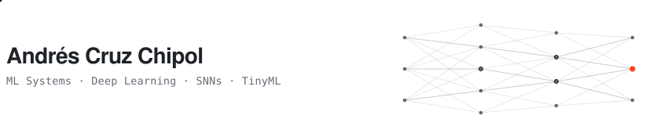

[LinkedIn](https://linkedin.com/in/andreschipol) · [Cinvestav Page](https://computacion.cs.cinvestav.mx/~andres.cruz/) · [Website](https://andreschipol.com) · [YouTube](https://youtube.com/@tu-canal)

Hi, I'm Andrés, a Computer Scientist and AI / ML Systems Engineer based in . I like building ML software from scratch and understanding how models actually run on real hardware.

Right now, I'm finishing my M.Sc. in Computer Science at **Cinvestav**, working on **Spiking Neural Networks (SNNs)**, Computer Vision, and **TinyML** deployment on constrained devices. I'm currently looking for new roles in AI/ML engineering.

### Outside

- I run a YouTube channel making technical videos on AI engineering, ML infrastructure, and system performance from the ground up.
- I build small, practical tools I actually use every day, from guitar utilities to lightweight mobile apps like *snakein* on Google Play.
- I keep my dev setup minimal with `zsh`, `VS Code`, `Vim`, and `scrcpy` (no heavy IDEs).
- In my free time, I play guitar, edit videos to unwind, and play *Minecraft*, *Cities: Skylines*, and *Resident Evil*.

If you're hiring for AI/ML systems roles or just want to talk about low-level engineering, feel free to message me on [LinkedIn](https://linkedin.com/in/andreschipol) 
 

